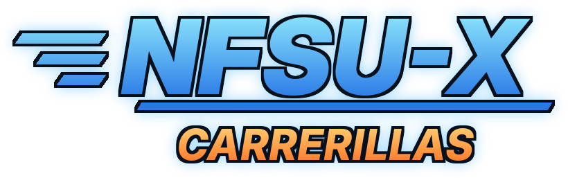

<div align="center">



### Recompilación estática de Xbox para Android

La versión original de Xbox (NTSC-U) de *Need for Speed: Underground*,
traducida instrucción a instrucción a C y ejecutada de forma nativa en Android,
sin emulador.

</div>

> **NFSU-X Carrerillas** es un proyecto de fans sin relación con Electronic Arts.
> *Need for Speed* y *Need for Speed: Underground* son marcas de Electronic Arts.
> El repositorio no incluye datos ni ejecutables del juego: necesitas tu propia
> copia original de Xbox (NTSC-U).

## Funciones

- **Traducción al español** del launcher, los ajustes y el editor de controles
  táctiles (también en inglés y ruso; sigue el idioma del sistema).
- **Pantalla de ajustes en el launcher**, sin editar archivos a mano:
  - Gráficos: 30/60 FPS, escala de resolución, FXAA, filtro anisotrópico,
    reflejos, desenfoque/bloom y píxeles cuadrados.
  - Formato de imagen: automático, panorámico 16:9 o clásico 4:3. En
    automático, las pantallas 4:3 (por ejemplo consolas retro Android) usan la
    imagen 4:3 original a pantalla completa, sin franjas negras.
  - Volumen general.
  - Idioma del juego (inglés, español, francés, alemán, italiano). El juego
    solo lo usa si su carpeta `LANGUAGES` lo incluye.
  - Inicio automático opcional.
- **Contador de FPS** en pantalla.
- **Copia de seguridad de partidas**: exporta e importa perfiles, progreso de
  la carrera y opciones en un `.zip`.
- **Jugar / Ajustes / Cambiar carpeta** al abrir la app.
- Aviso claro si la carpeta tiene otra versión del juego (por ejemplo PAL).
- Nombre, logo e icono propios.

- Controles táctiles personalizables en carrera, menús táctiles, vibración y
  compatibilidad con mandos.
- Renderizado Vulkan con panorámico 16:9 o 4:3, reflejos en los coches, mipmaps y FXAA.

Detalles técnicos (en inglés) en [android/README.md](android/README.md).

## Créditos

- Port para Android: [cherepavel](https://github.com/cherepavel) —
  [nfsu1-android](https://github.com/cherepavel/nfsu1-android).
- Basado en el port para Nintendo Switch de
  [antoxa2584x](https://github.com/antoxa2584x) —
  [nfsu1-sw](https://github.com/antoxa2584x/nfsu1-sw).
- Toolkit de recompilación: [xboxrecomp](xboxrecomp/).
- NFSU-X Carrerillas: [KB-retro](https://github.com/KB-retro).

## Instalación

1. Necesitas un móvil o consola Android **ARM64** con **Android 11 o superior**.
2. Descarga la APK (ver [Compilar con GitHub Actions](#compilar-con-github-actions))
   e instálala. Si Android lo pide, permite instalar apps de origen desconocido.
3. Copia en el móvil la carpeta del juego **extraída** de tu disco original de
   Xbox **NTSC-U (USA)**: debe contener `default.xbe`, `CARS`, `FRONTEND`,
   `GLOBAL`, `LANGUAGES`, `MOVIES`, `SOUND` y `TRACKS`. Puede estar en la
   memoria interna, una tarjeta SD o un USB. No se admite la ISO sin extraer.
4. Abre **NFSU-X Carrerillas**, pulsa **Seleccionar carpeta**, elige esa
   carpeta y concede el acceso de lectura.
5. Pulsa **Jugar**. En **Ajustes** puedes cambiar gráficos, sonido, idioma,
   el contador de FPS y hacer copias de seguridad de tus partidas.

La carpeta del juego se lee directamente y no se copia dentro de la app:
mantenla disponible mientras juegas. Las partidas, ajustes y registros se
guardan en `Android/data/org.nfsu.android/files/`.

Al actualizar a una APK nueva, normalmente se instala encima. Si Android no lo
permite (la firma puede cambiar entre compilaciones), exporta antes las
partidas en **Ajustes → Exportar partidas**, desinstala, instala la nueva e
impórtalas.

## Compilar con GitHub Actions

La forma más sencilla de obtener la APK, sin instalar nada en tu ordenador:

1. Haz un fork de este repositorio.
2. Sube tu `default.xbe` (NTSC-U, de tu propia copia) a un sitio con enlace de
   descarga directa y privado, por ejemplo Dropbox cambiando `?dl=0` por
   `?dl=1`.
3. En tu fork, ve a **Settings → Secrets and variables → Actions → New
   repository secret**, con nombre `NFSU_XBE_URL` y como valor ese enlace.
4. Ve a **Actions → Android APK → Run workflow**.
5. Cuando termine (unos 10 minutos), descarga la APK en la sección
   **Artifacts** de esa ejecución.

El `default.xbe` solo se descarga dentro de la máquina temporal de GitHub y no
se publica. La APK contiene código recompilado del juego, por eso el artifact
se guarda **solo un día**: en un repositorio público cualquier usuario de
GitHub con sesión iniciada podría descargarlo. Bórralo de la página de la
ejecución cuando lo tengas y no lo compartas.

## Compilar en tu ordenador

Instrucciones para Linux. La APK es para **ARM64**, Android 11 o superior
(API 30+).

### Requisitos

- Git, Python 3 con `venv` y `pip`, y JDK 21 o superior.
- Android SDK con la plataforma **37**, el NDK **30.0.16248370** y CMake
  **4.1.2**. Se instalan desde el SDK Manager de Android Studio o con
  `sdkmanager`.
- El `default.xbe` original de Xbox **NTSC-U** de tu copia del juego. Los datos
  del juego no se incluyen en el repositorio ni en la APK.

Gradle **9.8.0** se descarga con el wrapper; el Android Gradle Plugin **9.4.1**
ya está configurado. Compila desde un checkout de Git: el launcher muestra el
commit actual como número de compilación.

### Preparar y compilar

Desde la raíz del repositorio, descarga una vez las dependencias fijadas:

```sh
git submodule update --init --recursive
```

Abre la raíz del repositorio en Android Studio y elige tu JDK, o usa la línea
de comandos. En `local.properties` indica la ruta del SDK y del ejecutable del
juego (Git ignora este archivo):

```properties
sdk.dir=/ruta/a/Android/Sdk
nfsu.xbe=/ruta/a/Need For Speed Underground/default.xbe
```

Si no pones `nfsu.xbe`, Gradle usa `game/Need For Speed Underground/default.xbe`
relativo a la raíz del repositorio. Después compila:

```sh
./gradlew assembleDebug
```

Gradle crea su propio entorno virtual de Python, instala las dependencias del
generador, genera el código C a partir del XBE y compila las librerías nativas
y la APK. No hace falta usar `pip` a mano ni scripts de preparación. La primera
compilación necesita conexión a internet. El código generado se guarda en
`android/app/build/` y se regenera cuando cambian el XBE o el generador;
`clean` lo borra. Usa `-Pnfsu.xbe=/ruta/a/default.xbe` para cambiar el
ejecutable en una compilación y `-Pnfsu.python=/ruta/a/python3` para elegir el
intérprete de Python.

La APK se genera en `android/app/build/outputs/apk/debug/app-debug.apk`. Para
instalarla en un dispositivo conectado con depuración USB:

```sh
adb install -r android/app/build/outputs/apk/debug/app-debug.apk
```

## Licencia

Copyright (C) 2026 cherepavel. Modificaciones de NFSU-X Carrerillas (C) 2026
KB-retro.

El código de este proyecto se distribuye bajo la **Licencia Pública General de
GNU, versión 3 o (a tu elección) cualquier versión posterior**
(`SPDX-License-Identifier: GPL-3.0-or-later`). Consulta [LICENSE](LICENSE)
para los términos completos. Este software se ofrece sin ninguna garantía.

El código de terceros conserva sus avisos de copyright y licencia. En
particular, consulta [xboxrecomp/LICENSE](xboxrecomp/LICENSE),
[xboxrecomp/NOTICE](xboxrecomp/NOTICE) y los archivos de licencia de los
submódulos SDL y glslang.

La licencia GPL cubre el código del proyecto, no el ejecutable original del
juego, sus datos, logotipos, ilustraciones ni marcas. Estos siguen sujetos a
los derechos de sus respectivos propietarios; mencionarlos aquí no concede
ninguna licencia sobre ellos.
